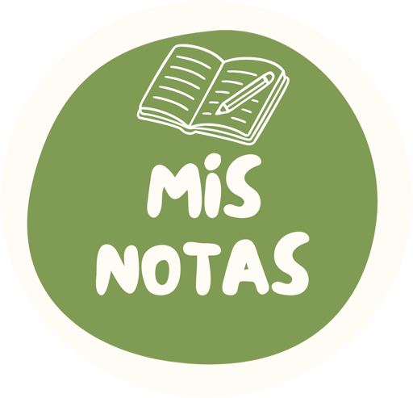

<p align="center">
  
</p>

<h1 align="center">Mis Notas</h1>

<p align="center">
  Notas en Markdown para Android, con carpetas, cifrado de extremo a extremo y sincronización con tu propio Nextcloud.
</p>

<p align="center">
  <a href="LICENSE"></a>
  <a href="https://github.com/ferlagod/mis_notas/actions/workflows/android.yml"></a>
  
</p>

---

Mis Notas combina el aspecto limpio de Apple Notas y Google Keep con la organización por carpetas y el Markdown de apps como Joplin o Notesnook. Tus notas viven en el teléfono, y si quieres se sincronizan **cifradas** con tu servidor Nextcloud: el servidor solo guarda datos ilegibles.

## Características

- **Local primero**: funciona sin conexión y sin cuenta. La sincronización es opcional.
- **Carpetas anidadas** con colores, notas fijadas y papelera con restauración (y vaciado automático a los 30 días, desactivable).
- **Markdown**: títulos, negrita, cursiva, tachado, código, bloques de código, citas, listas, listas numeradas, tablas, enlaces (también direcciones sueltas), separadores y **listas de tareas** que se marcan con un toque.
- **Editor cómodo**: deshacer/rehacer, las listas continúan solas al pulsar Intro, barra de formato que actúa sobre la línea o la selección, contador de palabras y tiempo de lectura.
- **Imágenes** adjuntas (varias a la vez; se comprimen a WebP y se sincronizan como ficheros cifrados aparte) con visor a pantalla completa y zoom.
- **Selección múltiple** con pulsación larga: fijar, cambiar color, mover de carpeta o borrar varias notas a la vez, y **"Deshacer"** al mandar algo a la papelera.
- **Vista de cuadrícula o lista**, orden por fecha o título, búsqueda instantánea que ignora acentos y resalta los resultados, progreso de las listas de tareas en cada tarjeta.
- **Compartir**: envía notas a otras apps, cópialas o duplícalas, y crea notas desde "Compartir" en cualquier app (texto o imágenes). Acceso directo "Nueva nota" manteniendo pulsado el icono.
- **Copia de seguridad en Markdown**: exporta todo a un ZIP (carpetas, imágenes y metadatos) e importa `.zip`, `.md` y `.txt`. Compatible con Obsidian, Joplin, etc.
- **Bloqueo de la app** con huella, cara o PIN del dispositivo, y contenido oculto en las apps recientes.
- **Móviles plegables y tablets**: en pantallas anchas la lista y la nota se ven lado a lado; al plegar el móvil la nota sigue abierta sin perder nada.
- **Sincronización con Nextcloud** (WebDAV) automática: al abrir la app, al editar y cada ~30 minutos en segundo plano.
- **Cifrado de extremo a extremo** AES-256-GCM con una contraseña maestra que nunca sale del dispositivo.
- **Sin conflictos silenciosos**: si una nota se edita a la vez en dos dispositivos, se conservan ambas versiones.
- Diseño de la familia **Mis Apps** (compartido con Mis Podcast): tipografías Outfit e Inter, verde del logo como color principal, tema claro, oscuro o del sistema con opción de negro puro AMOLED, e icono temático en Android 13+.
- **Disponible en español, inglés, francés, alemán e italiano**: se elige en Ajustes (o "Idioma del sistema"). En Android 13+ también desde los ajustes de idioma del sistema.
- Sin anuncios, sin rastreadores, sin servicios de Google.

## Instalación

1. Descarga el último `.apk` desde la página de [Releases](https://github.com/ferlagod/mis_notas/releases).
2. Ábrelo en tu teléfono y permite la instalación desde esa fuente si Android te lo pide.

Requisitos: Android 8.0 (API 26) o superior.

## Conectar con Nextcloud

1. En la web de tu Nextcloud ve a **Ajustes personales → Seguridad → Dispositivos y sesiones** y crea una **contraseña de aplicación** (por ejemplo "Mis Notas"). No uses tu contraseña normal.
2. En la app, abre **Ajustes** (icono de engranaje) → **Sincronización con Nextcloud** e introduce:
   - **Servidor**: la dirección de tu Nextcloud, p. ej. `https://nube.ejemplo.com`.
     También puedes pegar una URL WebDAV completa (`https://…/remote.php/dav/files/usuario/carpeta`).
   - **Usuario** y la **contraseña de aplicación** del paso 1.
   - **Contraseña maestra**: la que cifra tus notas.
3. Pulsa **Conectar y cifrar**. La app crea la carpeta `MisNotas` en tu Nextcloud y sube tus notas cifradas.

### Usar varios dispositivos

Instala la app en el otro dispositivo y conéctalo con la **misma cuenta y la misma contraseña maestra**. Si la contraseña no coincide, la app te avisará y no subirá nada.

> [!WARNING]
> **Si olvidas la contraseña maestra, no hay forma de recuperar las notas guardadas en el servidor.** Ni el administrador de Nextcloud ni el autor de la app pueden descifrarlas. Guárdala en un gestor de contraseñas.

## Seguridad en breve

- La clave se deriva de tu contraseña maestra con PBKDF2-HMAC-SHA256 (600.000 iteraciones) y un *salt* aleatorio.
- Cada nota, carpeta e imagen se cifra con AES-256-GCM antes de salir del teléfono. El título, el contenido, la carpeta, el color y las fechas van todos dentro del bloque cifrado.
- Cada bloque cifrado queda vinculado a su identificador, así que el servidor no puede intercambiar ni modificar ficheros sin que la app lo detecte.
- Las credenciales y la clave se guardan en el dispositivo con `EncryptedSharedPreferences` (Android Keystore).
- Las notas **no** se incluyen en la copia de seguridad en la nube de Google.

Lo que **no** protege: el servidor puede ver cuántas notas tienes, su tamaño aproximado y cuándo cambian. En el teléfono las notas se guardan sin cifrar dentro del almacenamiento privado de la app, que Android protege con el cifrado del propio dispositivo.

Detalles técnicos en [SECURITY.md](SECURITY.md) y en el [formato de sincronización](docs/SYNC_FORMAT.md).

## Cómo funciona la sincronización

- Cada nota y carpeta es un fichero JSON cifrado en `MisNotas/` de tu Nextcloud (`note_<id>.json`, `folder_<id>.json`); las imágenes son `att_<id>.bin`.
- La app usa los ETag de WebDAV para descargar solo lo que ha cambiado y `If-Match` al subir, para no sobrescribir nunca un cambio que no ha visto.
- **Conflictos**: si la misma nota cambió en dos sitios, se queda la versión más reciente y la otra se guarda como una nota nueva con el título "… (conflicto)".
- **Borrados**: la papelera se sincroniza entre dispositivos. Al vaciarla, la app deja en el servidor una "lápida" para que el resto de dispositivos también la borren.
- Al eliminar una carpeta, sus notas pasan a "Todas las notas" y sus subcarpetas suben un nivel.

## Compilar desde el código

Necesitas JDK 21 y el Android SDK (Android Studio lo instala todo).

```bash
git clone https://github.com/ferlagod/mis_notas.git
cd mis_notas
./gradlew assembleDebug          # APK de depuración en app/build/outputs/apk/debug/
./gradlew testDebugUnitTest      # tests unitarios
./gradlew lintDebug              # análisis estático (lo ejecuta también el CI)
```

### Firmar una versión release

1. Crea un almacén de claves (una sola vez y **guárdalo bien**: sin él no podrás publicar actualizaciones):
   ```bash
   keytool -genkeypair -v -keystore misnotas-release.jks -alias misnotas -keyalg RSA -keysize 4096 -validity 10000
   ```
2. Copia `keystore.properties.example` a `keystore.properties` y rellénalo. Ese fichero está en `.gitignore`.
3. Ejecuta `./gradlew assembleRelease`. El APK queda en `app/build/outputs/apk/release/`.

Para firmar en GitHub Actions, consulta [CONTRIBUTING.md](CONTRIBUTING.md#publicar-una-versión).

## Estructura del proyecto

```
app/src/main/java/com/ferlagod/misnotas/
├── data/
│   ├── attachment/   Almacén local de imágenes adjuntas
│   ├── backup/       Exportar/importar notas en Markdown (ZIP)
│   ├── local/        Room: entidades, DAOs, migraciones, árbol de carpetas, preferencias
│   ├── remote/       Cliente WebDAV (OkHttp)
│   └── sync/         Bóveda, formato remoto, reglas de fusión, sincronización y WorkManager
├── security/         Cifrado (PBKDF2 + AES-GCM)
├── ui/               Pantallas Jetpack Compose, componentes, tema, lector y editor Markdown
└── util/             Imágenes, idioma, búsqueda y bloqueo de la app

app/src/main/res/values*/strings.xml   Textos (inglés por defecto; es, fr, de, it)
```

## Limitaciones conocidas

- Todavía no se puede **cambiar la contraseña maestra** de una cuenta existente.
- Las imágenes que ya no usa ninguna nota se borran del teléfono, pero **no del servidor**.
- Solo admite imágenes como adjuntos.
- Por ahora solo hay app para Android.

¿Ideas o fallos? Abre una [incidencia](https://github.com/ferlagod/mis_notas/issues).

## Contribuir

Las contribuciones son bienvenidas. Lee [CONTRIBUTING.md](CONTRIBUTING.md) antes de abrir un *pull request*. Para vulnerabilidades, sigue [SECURITY.md](SECURITY.md).

## Créditos

- Tipografías [Outfit](https://github.com/Outfitio/Outfit-Fonts) (© 2021 The Outfit Project Authors) e [Inter](https://github.com/rsms/inter) (© 2016 The Inter Project Authors), bajo la [SIL Open Font License 1.1](https://openfontlicense.org). La licencia va incluida en los propios ficheros de fuente.

## Licencia

Copyright © 2026 ferlagod

Este programa es software libre: puedes redistribuirlo y/o modificarlo bajo los términos de la **Licencia Pública General de GNU** publicada por la Free Software Foundation, ya sea la versión 3 de la Licencia o (a tu elección) cualquier versión posterior.

Se distribuye con la esperanza de que sea útil, pero **SIN NINGUNA GARANTÍA**; ni siquiera la garantía implícita de COMERCIABILIDAD o IDONEIDAD PARA UN PROPÓSITO PARTICULAR. Consulta el fichero [LICENSE](LICENSE) para más detalles.

*Nextcloud es una marca registrada de Nextcloud GmbH. Este proyecto no está afiliado a Nextcloud GmbH, Apple, Google, Joplin ni Notesnook.*
